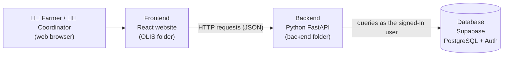
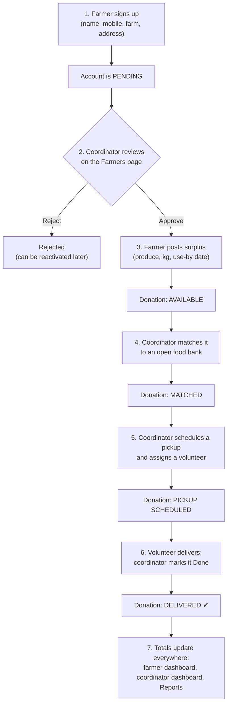
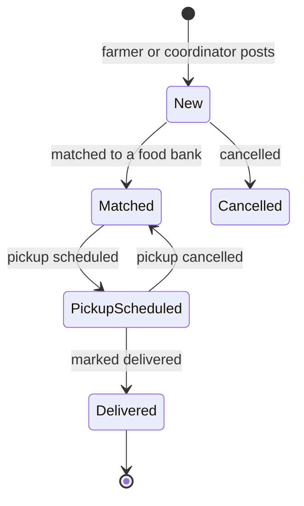
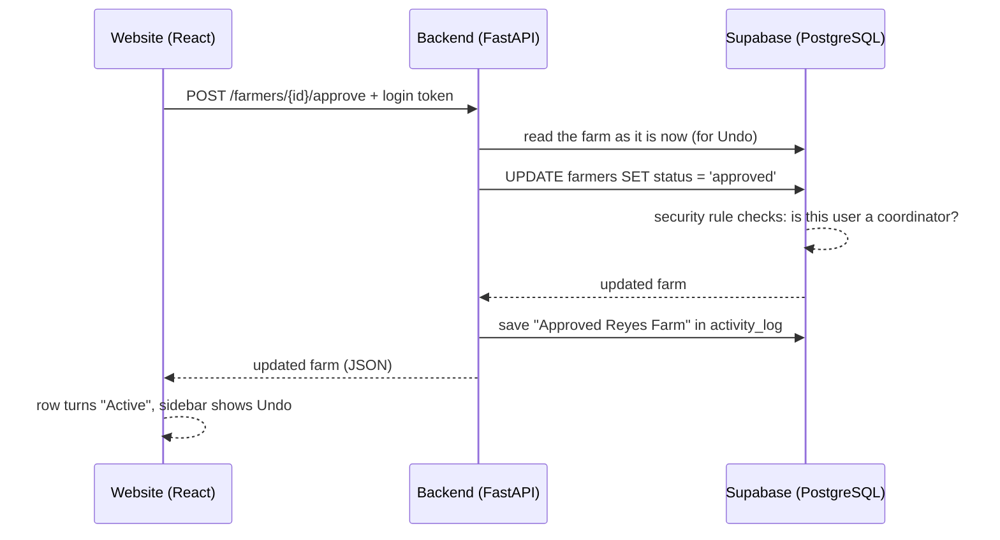
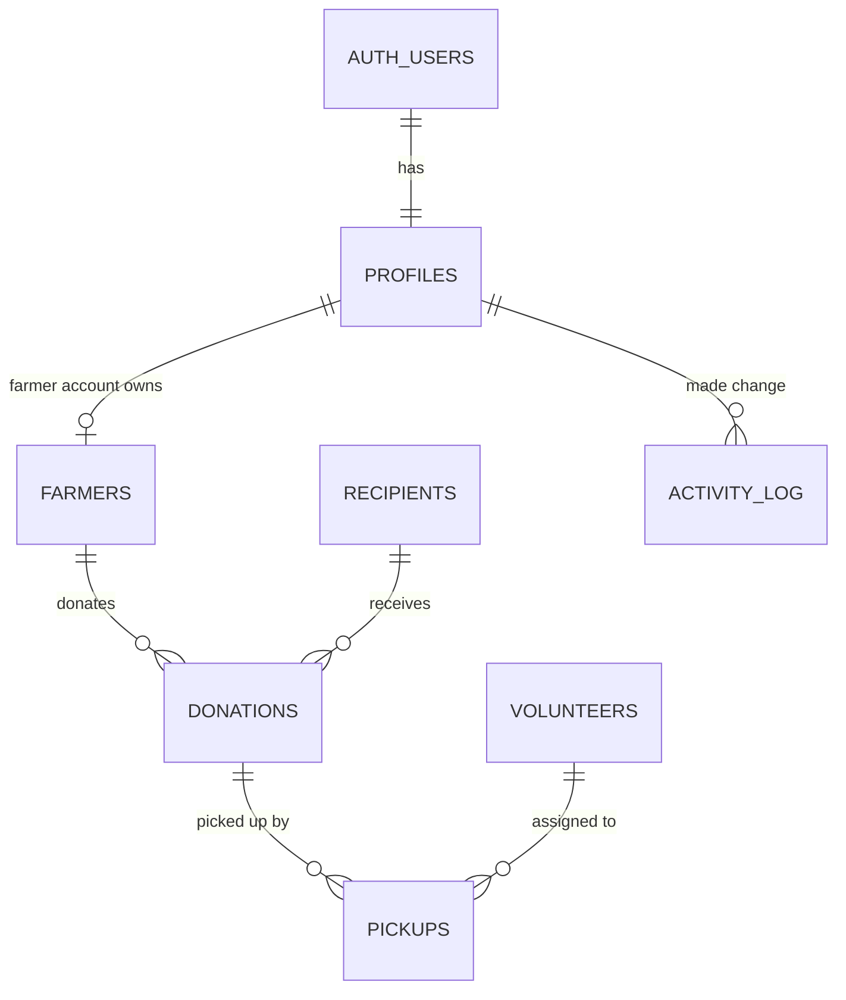
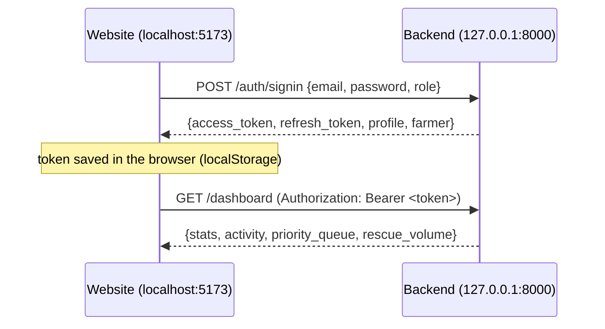

# Silo — Community Food Rescue Network

> *Every harvest has a home.*

Silo is a web system that moves **surplus harvest from local farms to food banks, community kitchens and pantries** before it spoils. Farmers post the produce they can't sell, a coordinator matches it to a food bank, a volunteer picks it up, and the system keeps a record of every kilogram rescued.

---

## Contents

1. [How the system works](#1-how-the-system-works)
2. [Languages used](#2-languages-used-in-the-frontend-and-backend)
3. [The flow of the system](#3-the-flow-of-the-system)
4. [Who benefits and how](#4-who-benefits-and-how)
5. [Database used](#5-database-used)
6. [How the frontend and backend connect](#6-how-the-frontend-and-backend-connect)
7. [How the database connects to the system](#7-how-the-database-connects-to-the-system)
8. [Sorting algorithms used](#8-sorting-algorithms-used-in-the-system)
9. [Purpose of Node.js](#9-purpose-of-nodejs-in-our-system)
10. [Running the system](#10-running-the-system)

---

## 1. How the system works

Silo has **three parts** that work together:



| Part | What it does |
|---|---|
| **Frontend** (the website) | What people see and click: login, sign-up, dashboards, tables, forms, charts. It never talks to the database directly. |
| **Backend** (the Python API) | The "brain". Receives requests from the website, checks who is asking, applies the rules (e.g. a pickup that is completed marks the donation as delivered), calculates reports, and reads/writes the database. |
| **Database** (Supabase) | Stores everything: accounts, farms, donations, pickups, volunteers, food banks, and the undo history. It also enforces security rules so each person only sees what they're allowed to. |

There are two kinds of users, each with their own login and dashboard:

| Role | How the account is made | What they can do |
|---|---|---|
| **Farmer** (donor) | Signs up on the website. Starts as **Pending** until a coordinator approves. | Post surplus harvest, follow each donation (which food bank, pickup time, volunteer), see how many kg they've rescued. Sees **only their own farm**. |
| **Coordinator** (admin) | Created by the operating office (barangay, city agriculture office, NGO or food bank network) in Supabase. No public sign-up. | Approve/reject/suspend farmers, match donations to food banks, schedule pickups, assign volunteers, manage volunteers and recipients, view reports, undo mistakes. |

The coordinator's pages:

| Page | Purpose |
|---|---|
| **Dashboard** | Today at a glance: active donations, pickups today, farmers waiting for review, food rescued, a priority queue and a rescue-volume chart. |
| **Donations** | Every donation. Match it to a food bank, schedule its pickup, or cancel it. |
| **Pickups** | The pickup schedule. Assign or change the volunteer, reschedule, mark delivered, or cancel. |
| **Farmers** | New applications and partner farms. Approve, reject, suspend or reactivate. |
| **Volunteers** | Drivers and helpers: service area, vehicle and capacity, on/off duty. |
| **Recipients** | Food banks, kitchens and pantries: capacity, priority needs, open / limited / closed. |
| **Reports** | Kilograms rescued over 7 days, 30 days or 12 months, where the food went, top farms, produce, food banks and volunteers. |

Other features: **Undo last action** (in the coordinator sidebar), **Forgot password** (both logins), pages that **refresh on their own** every 30 seconds, and a design that works on **phones**.

---

## 2. Languages used in the frontend and backend

### Frontend — `OLIS/`

| Language / tool | Used for |
|---|---|
| **TypeScript** (`.ts`, `.tsx`) | All website logic: screens, forms, talking to the backend. TypeScript is JavaScript with types, which catches mistakes before the site runs. |
| **React 19** (TSX / JSX) | Building the screens out of reusable components (`AppShell`, `PageMetrics`, `StatusPill`, …). |
| **CSS** with **Tailwind CSS v4** | Styling, layout, colors, mobile layout (`src/index.css`). |
| **HTML** | The page shell (`index.html`) that the React app is loaded into. |
| **Vite** | Development server and build tool (runs on Node.js — see section 9). |

### Backend — `backend/`

| Language / tool | Used for |
|---|---|
| **Python 3.9+** | The whole backend. |
| **FastAPI** | The web API framework: defines the endpoints (`/auth/signin`, `/donations`, `/reports`, …) and creates the interactive docs at `/docs`. |
| **Pydantic** | Checks every request (e.g. email format, quantity must be more than 0, password at least 6 characters). |
| **supabase-py** | Python library for talking to Supabase (database + login). |
| **httpx** | Direct calls to Supabase's login service for password reset. |
| **Uvicorn** | The server program that runs the FastAPI app. |

### Database — `backend/supabase/`

| Language | Used for |
|---|---|
| **SQL** (PostgreSQL) | Tables, relationships, views for the dashboard (`migrations/*.sql`). |
| **PL/pgSQL** | Database functions and triggers, e.g. creating a farmer's profile and farm record automatically when they sign up. |

---

## 3. The flow of the system

### The main flow: from surplus harvest to a food bank



At every step the **farmer sees the update on their own dashboard** (which food bank, pickup time, volunteer, delivered).

### Donation status



### What happens behind one click

Example: the coordinator clicks **Approve** on a farmer.



---

## 4. Who benefits and how

| Who | How Silo helps |
|---|---|
| **Farmers** | Surplus or unsold harvest goes to people instead of rotting in the field. Posting takes a minute, and they can see exactly where their produce went and how much they've contributed. |
| **Food banks, community kitchens, pantries, shelters** | Get a steady supply of fresh produce matched to what they need and can handle (priority needs, capacity, open / limited / closed). |
| **Families and individuals they serve** | More fresh fruits and vegetables in meals. Reports estimate the meals provided (about 0.5 kg of produce per meal). |
| **Volunteers** | A clear schedule: what to pick up, where, when, and where to deliver it. Coordinators only assign volunteers who are on duty. |
| **Coordinators** (barangay, city agriculture office, NGO, food bank network) | One place to run everything instead of calls and spreadsheets: a priority queue, ready-made reports for meetings and funding, and Undo for mistakes. |
| **The community and environment** | Less food waste going to landfill, and a record of how many kilograms were rescued. |

---

## 5. Database used

Silo uses **[Supabase](https://supabase.com)**, which provides:

- a **PostgreSQL** database (a relational SQL database), and
- **Supabase Auth** for accounts, passwords, login tokens and password-reset emails.

### Tables



| Table | What it stores |
|---|---|
| `auth.users` | Login accounts (managed by Supabase Auth). |
| `profiles` | Name, phone, organization and **role** (`farmer`, `coordinator`, `admin`, `volunteer`). |
| `farmers` | Farm name, contact, address, cooperative, status (`pending`, `approved`, `rejected`, `suspended`). |
| `donations` | Produce, kg, farm, food bank, use-by date, status (`new`, `matched`, `pickup_scheduled`, `delivered`, …). |
| `pickups` | Which donation, scheduled time, volunteer, status (`scheduled`, `completed`, `cancelled`). |
| `volunteers` | Name, phone, service area, vehicle, capacity in kg, on/off duty. |
| `recipients` | Food banks / kitchens / pantries: type, location, capacity, needs, open / limited / closed. |
| `activity_log` | Each coordinator change and what the record looked like before it (used by **Undo**). |

Views (saved queries) used by the Dashboard: `dashboard_stats`, `donation_activity`, `rescue_volume_daily`.

The database is created by running the SQL files in `backend/supabase/migrations/` in order. `seed.sql` adds optional sample data.

---

## 6. How the frontend and backend connect

The website and the backend are **two separate programs** that talk over **HTTP using JSON**, like a waiter (website) passing orders to the kitchen (backend).



- **Where:** all website ↔ backend code is in **`OLIS/src/lib/api.ts`**. It uses the browser's `fetch()` to call the backend at `http://127.0.0.1:8000` (changeable with `VITE_API_URL` in `OLIS/.env`).
- **Login token:** after logging in, the website keeps a **token** (a signed pass from Supabase) and sends it with every request in the `Authorization: Bearer …` header. That's how the backend knows *who* is asking.
- **Staying logged in:** tokens expire after about an hour; `api.ts` automatically asks the backend for a fresh one (`/auth/refresh`).
- **Errors:** the backend answers with clear messages (e.g. *"This is a farmer account. Please use the farmer login."*) which the website shows to the user.
- **CORS:** browsers block websites from calling other servers unless allowed. The backend allows the website's address (any `localhost` port) in `backend/app/config.py`.
- **Endpoints:** every backend address the website uses is listed in [`backend/README.md`](backend/README.md#endpoints) and can be tried at **http://127.0.0.1:8000/docs**.

---

## 7. How the database connects to the system

Only the **backend** connects to the database. The connection is set up in **`backend/app/db.py`** using two values from **`backend/.env`**:

```
SUPABASE_URL=https://<your-project>.supabase.co
SUPABASE_ANON_KEY=<publishable key>
```

How a request reaches the data:

1. The website sends a request with the user's login token.
2. `db.py` creates a Supabase client **acting as that user** (`client.postgrest.auth(token)`).
3. The query goes to Supabase's API, which runs it on **PostgreSQL**.
4. PostgreSQL applies the **Row Level Security (RLS)** rules written in the migrations before returning anything.

That is why the security lives in the database itself, not only in the website:

| Rule (from the migrations) | Effect |
|---|---|
| Farmers see their own farm, donations and pickups only | Even if someone edits the website, a farmer can't load other farms' data. |
| Only coordinators/admins can add, edit or delete | Volunteers' accounts are view-only. |
| Approved farmers can post donations for their own farm only | Pending or suspended farmers can't post. |
| Nobody can give themselves a different role | Roles are changed only by an admin or in the Supabase dashboard. |

Automatic database work:

- **On sign-up**, a trigger (`handle_new_user`) creates the person's `profiles` row and, for farmers, a `farmers` row with status `pending`.
- **Views** pre-calculate the dashboard numbers.
- The backend **never uses the secret `service_role` key**, so every action is checked by these rules.

---

## 8. Sorting algorithms used in the system

Silo sorts data in three places. We use the sorting built into each language rather than writing our own, because those are well-tested and fast.

| Where | What is sorted | How (code) | Algorithm behind it |
|---|---|---|---|
| **Database** (PostgreSQL) | Lists shown on pages: newest donations/farmers/volunteers first, pickups by scheduled time, the farmer's donations, the dashboard activity feed, the chart by day | `.order("created_at", desc=True)` in `crud.py` and `farmer.py`, `.order("scheduled_at")` in `resources.py`, `ORDER BY` in the dashboard views | **Quicksort** when the rows fit in memory, **external merge sort** for very large results, and **top-N heapsort** when combined with `LIMIT` (e.g. "latest 8 activities"). PostgreSQL chooses automatically. |
| **Backend** (Python) | Reports: top farms, produce and food banks by kg; volunteers by number of pickups; "where it went" by kg; the farmer's next pickup | `sorted(..., key=..., reverse=True)` in `reports.py` and `farmer.py` | **Timsort** — a hybrid of **merge sort** and **insertion sort**. Stable and *O(n log n)*. |
| **Frontend** (TypeScript) | The next upcoming pickup for a donation; most-donated produce on the Farmers page | `.sort((a, b) => …)` in `App.tsx` | **Timsort** as well (used by the V8 JavaScript engine in Chrome, Brave and Edge for `Array.prototype.sort`). |

Example from `backend/app/routers/reports.py` — ranking top farms by kilograms donated:

```python
def _top(totals, limit=5):
    ranked = sorted(totals.items(), key=lambda item: item[1], reverse=True)[:limit]
    return [{"name": name, "kg": round(kg, 2)} for name, kg in ranked]
```

---

## 9. Purpose of Node.js in our system

Node.js is **only used to develop and build the website**. It does **not** run the backend (that's Python) and it is **not** needed by the people using Silo — their browser runs the finished website.

| What Node.js does | Command |
|---|---|
| **Installs the website's libraries** (React, TypeScript, Vite, Tailwind) into `OLIS/node_modules` through **npm**, the Node package manager | `npm install` |
| **Runs the development server** (Vite) that shows the website at `localhost:5173` and updates the page instantly when code is saved | `npm run dev` |
| **Builds the final website** — turns TypeScript/TSX into plain JavaScript and Tailwind into regular CSS, and bundles everything into small files in `OLIS/dist` that any web host can serve | `npm run build` |
| **Formats code** | `npm run format` |

In short: **Node.js = the toolbox for building the frontend**; **Python = the backend server**; **Supabase = the database**.

---

## 10. Running the system

You need **Node.js**, **Python 3.9+**, and the Supabase project set up (see [`backend/README.md`](backend/README.md) for the database steps and creating a coordinator account).

**Terminal 1 — backend**

```bash
cd backend
python3 -m venv .venv            # first time only
source .venv/bin/activate        # every time (Windows: .venv\Scripts\activate)
pip install -r requirements.txt  # first time only
cp .env.example .env             # first time only, then paste the Supabase key into .env
uvicorn app.main:app --reload --reload-dir app
```

**Terminal 2 — website**

```bash
cd OLIS
npm install                      # first time only
npm run dev
```

Open **http://localhost:5173**.

### Project structure

```
Siloo/
├── README.md              ← this file
├── OLIS/                  ← FRONTEND (React + TypeScript, built with Node.js/Vite)
│   ├── index.html
│   ├── package.json       ← website libraries and npm scripts
│   └── src/
│       ├── App.tsx        ← all screens (login, dashboards, pages)
│       ├── index.css      ← styles
│       └── lib/api.ts     ← connection to the backend
└── backend/               ← BACKEND (Python FastAPI)
    ├── README.md          ← setup steps and full endpoint list
    ├── requirements.txt   ← Python libraries
    ├── .env.example       ← Supabase URL and key template
    ├── app/
    │   ├── main.py        ← starts the API
    │   ├── db.py          ← database connection
    │   ├── activity.py    ← Undo history
    │   └── routers/       ← auth, farmer, dashboard, reports, resources, history
    └── supabase/
        ├── migrations/    ← SQL that creates the database (run in order)
        └── seed.sql       ← optional sample data
```
